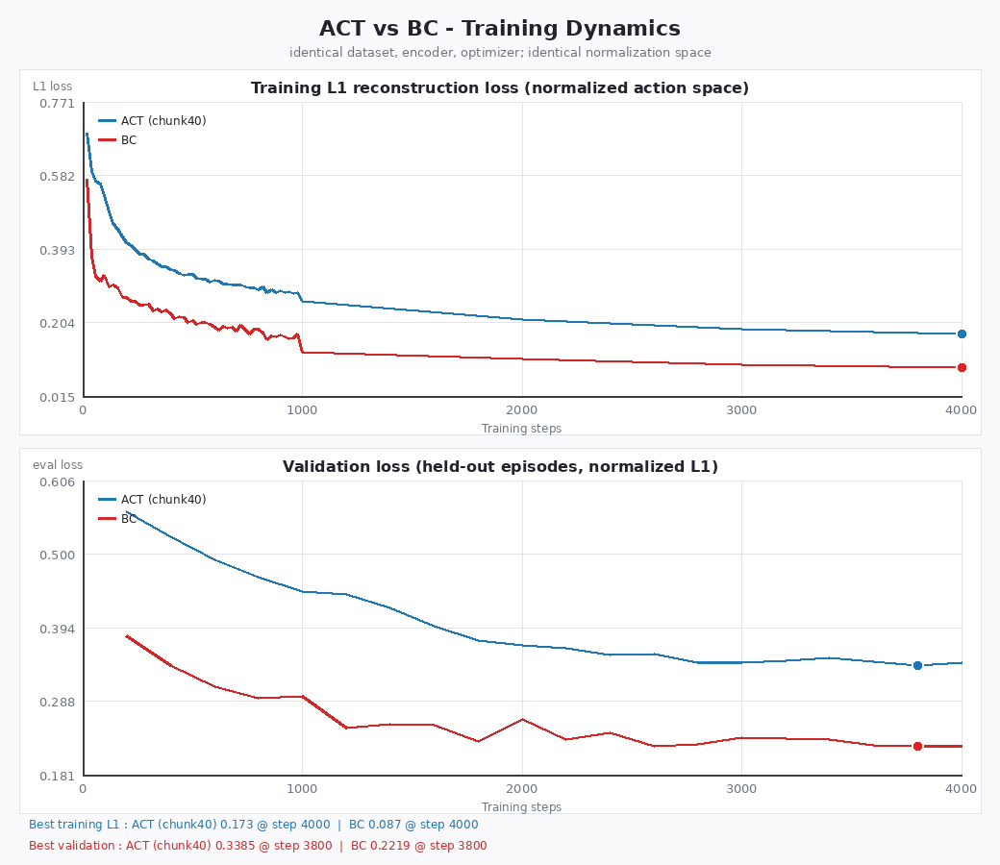
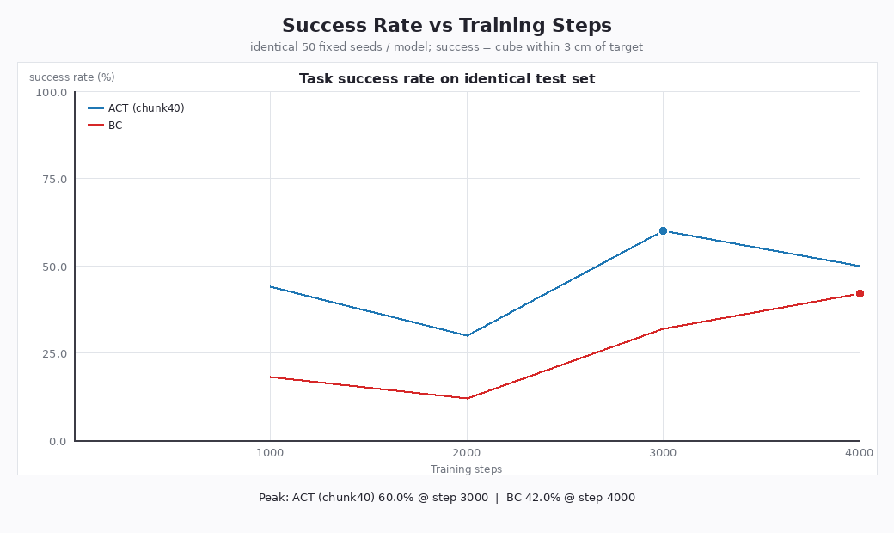
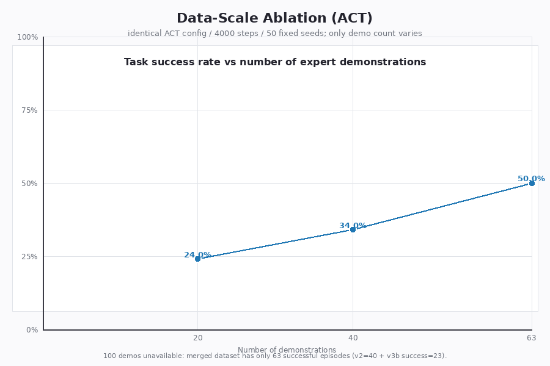
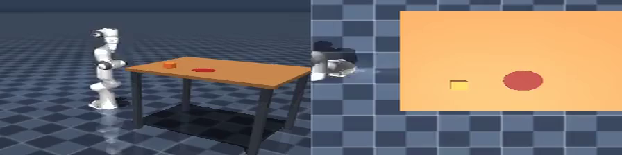

# embodied-policy-zoo

> 面向桌面操作的具身模仿学习算法仓库：以 Franka Panda 推立方体为任务，
> 用 LeRobot 0.7.0 的 ACT 策略做训练、量化评估与算法对比。

本仓库是 `embodied-policy-zoo` 系列的**纯策略（算法）仓库**：消费兄弟仓库
[`mujoco-studio-lab`](https://github.com/wzh0310/mujoco-studio-lab) 导出的专家演示数据，
聚焦「给定数据集与环境，如何训练、评估、对比模仿学习策略」。仿真场景、Gym 环境、
数据生成均不在本仓库，通过 `STUDIO_LAB_ROOT` 引用。**全程使用末端笛卡尔增量控制，
不涉及底层关节力矩控制。**

---

## 目录

- [1. 项目背景](#1-项目背景)
- [2. 任务与环境](#2-任务与环境)
- [3. 核心实现](#3-核心实现)
- [4. 环境依赖与快速上手](#4-环境依赖与快速上手)
- [5. 实验结果](#5-实验结果)
- [6. 效果演示](#6-效果演示)
- [7. 后续规划](#7-后续规划)
- [附录：仓库结构与文档索引](#附录仓库结构与文档索引)

---

## 1. 项目背景

视觉输入的具身模仿学习面临两个核心困难：

1. **误差累积**：逐步行为克隆在长时程操作中，微小误差会不断放大，导致轨迹漂移。
2. **多峰性**：同一观测下存在多种合理动作，简单回归会输出"折中动作"。

ACT（Action Chunking with Transformers）用**动作分块**与**CVAE 建模条件分布**应对上述问题。
本项目在 Panda 推立方体任务上落地 ACT，并与行为克隆（BC）在完全相同的数据、编码器、
训练配置和测试集下做公平对比，量化 ACT 的算法价值，形成可复现的策略基线。

**核心结论（先说结果）**：在同一批 50 个固定种子上，ACT 成功率 **50.0%** vs BC **42.0%**，
位置误差 **5.55cm** vs **12.25cm**（降低 55%）——ACT 的优势来自分块带来的轨迹连贯性，
而非单帧拟合精度（BC 的验证集动作 MSE 反而略低）。

---

## 2. 任务与环境

### 2.1 PushCube 任务

Franka Panda 机械臂将桌面上的立方体推入红色目标圆盘区域。立方体初始位置带随机偏移，
机械臂需通过相机观测判断相对方位并输出连续的末端位移。

### 2.2 观测与动作空间

| 空间 | 字段 | 形状 | 说明 |
|---|---|---|---|
| 观测 | `observation.images.main` | `224×224×3` uint8 | 第一人称俯视 RGB，策略的唯一视觉输入 |
| 观测 | `observation.state` | 低维 float32 | 夹爪位置 + 立方体位置（本体状态） |
| 动作 | `action` | 4 维 float32 | `[dx, dy, dz, gripper]`：**末端笛卡尔增量** |

> **关键约束**：输出是末端执行器在小时间步内的**位移增量**（每维约 ±0.02m），
> 经 MuJoCo `mocap + weld` 驱动机械臂；`gripper` 该任务恒为 0。
> **不涉及关节角度/力矩等底层控制**，因此属于纯策略层问题。

### 2.3 跨仓分工

| 职责 | 仓库 |
|---|---|
| MJCF 场景 / Gym 环境 / LeRobot 环境注册 / 专家数据采集 | [`mujoco-studio-lab`](https://github.com/wzh0310/mujoco-studio-lab) |
| 策略训练 / 评估 / 消融 / 量化基线（本仓库） | `embodied-policy-zoo` |

---

## 3. 核心实现

### 3.1 算法架构（数据流）

```
[224×224 RGB 图像] ──> ImageNet 预训练 ResNet-18 ──┐
                                                    ├─> Transformer 编码器 ──> CVAE 先验/解码器
[本体状态 state] ──────> 线性投影 ─────────────────┘                              │
                                                                                  ▼
                                                                  未来 chunk_size 步动作序列
                                                                                  │
                                                                    动作队列按 n_action_steps 消费
                                                                                  ▼
                                                                  末端增量 [dx,dy,dz,gripper] ──> 环境
```

- 本仓库最优配置：`chunk_size = n_action_steps = 40`，ImageNet ResNet-18，
  单层 Transformer（dim_model=128, n_heads=8）+ 8 维 latent，4000 步训练、batch 32、
  lr 1e-5、余弦退火。
- BC 基线为 LeRobot 原生等价实现：ACT 关闭 CVAE（`use_vae:false`）+ 关闭分块（`chunk_size=1`），
  共享同一编码器与数据，因此**唯一变量是算法本身**。

### 3.2 关键技术点

| 技术点 | 作用 | 本仓库实践 |
|---|---|---|
| **预训练视觉迁移** | 用 ImageNet 权重初始化 ResNet-18，缓解小数据过拟合 | 所有 ACT/BC 配置统一启用 |
| **动作分块（Action Chunking）** | 一次预测未来多步，降低决策频率，抑制误差累积 | chunk 4/8/16/20/30/40/50 全量消融；本任务在 40 附近出现突破 |
| **CVAE 多峰建模** | 建模"观测→动作序列"的条件分布，推理取确定性先验 | BC 对照实验证明其净增益 |
| **数据增强** | 图像增强缓解分布偏移 | 短训有效，但完整训练下反而有害（见消融报告），最终最优配置未启用 |
| **动作归一化** | mean/std 归一化 + checkpoint 自带 postprocessor 反归一化 | 推理端严禁二次反归一化（见复盘文档） |

### 3.3 仓库结构

```
embodied-policy-zoo/
├── configs/          # 所有训练配置（ACT/BC、消融分组，YAML 用路径占位符）
├── envs/             # 环境适配层（对接 mujoco-studio-lab 的 PushCubeEnv）
├── scripts/          # 训练 / 评估 / 消融 / 绘图 / 演示录制（含 run.py 一键入口）
├── results/          # 实验图表、量化表格、日志
├── assets/           # 演示视频、结果截图
├── docs/             # 深度技术文档
└── README.md
```

---

## 4. 环境依赖与快速上手

### 4.1 环境依赖

核心组合（实测可用）：Python 3.12、PyTorch 2.6.0+cu124、LeRobot 0.7.0、
gymnasium 1.4.0、mujoco 4.0.1、CUDA 12.4。完整版本见 [`requirements.txt`](requirements.txt)。

```bash
# 由 requirements.txt 安装（PyTorch 需按文件顶部注释用 cu124 源单独安装）
pip install -r requirements.txt
# 克隆兄弟仓库并声明路径（本仓库脚本据此加载环境和数据）
git clone https://github.com/wzh0310/mujoco-studio-lab ../mujoco-studio-lab
export STUDIO_LAB_ROOT=$(pwd)/../mujoco-studio-lab
```

> PyTorch 说明：宿主机驱动支持 CUDA 12.4，故用 `torch 2.6.0+cu124`；
> cu124 是与驱动匹配的最高官方 wheel，不盲目升级。

### 4.2 三步复现

```bash
# 步骤 1：训练（--algo 指定算法，--config 指定配置）
python scripts/run.py train --algo act \
  --config configs/act_push_cube/ablation/chunk40.yaml --steps 4000 --device cuda

# 步骤 2：评估（固定 50 种子，输出量化指标）
python scripts/run.py eval \
  --checkpoint ../outputs/act_chunk40/checkpoints/004000 \
  --out results/metrics/my_eval.json

# 步骤 3：录制演示（双视角短视频）
python scripts/run.py record --checkpoint ../outputs/act_chunk40/checkpoints/004000
```

> 快速冒烟（验证全链路，单进程避免数据加载 worker 死锁）：
> ```bash
> python scripts/run.py train --algo bc \
>   --config configs/act_push_cube/bc_baseline.yaml --steps 5 \
>   --num-workers 0 --output-dir /tmp/zoo_smoke --force
> ```

配置中的 `${STUDIO_LAB_ROOT}` / `${OUTPUTS_DIR}` 会在训练入口自动展开，
克隆到任意机器都无需改配置。`python scripts/run.py --help` 查看全部一键子命令
（训练/对齐评估/动作 MSE/checkpoint 曲线/数据量消融/绘图）。

---

## 5. 实验结果

### 5.1 ACT vs BC 量化对比（可直接用于文档/简历）

统一协议：50 个固定种子、同一测试集；动作 MSE 由 teacher-forcing 在 13 条 held-out
episode（488 帧）上计算。

| 算法 | 任务成功率 | 平均完成步数 | 最终位置误差 (cm) | 验证集动作 MSE |
| --- | --- | --- | --- | --- |
| BC | 42.0% (21/50) | 34.33 | 12.25 | 3.24e-06 |
| ACT (chunk40) | **50.0% (25/50)** | 35.12 | **5.55** | 3.71e-06 |

**反直觉洞察**：BC 的单帧动作 MSE 反而略低，说明 ACT 的优势不在单帧拟合精度，
而在分块规划带来的轨迹连贯性——与 chunk 消融中 ACT 方向翻转率降至 0 的结论相互印证。
详见 [`docs/BC_BASELINE_REPORT.md`](docs/BC_BASELINE_REPORT.md) 与
[`docs/STANDARD_EVAL_REPORT.md`](docs/STANDARD_EVAL_REPORT.md)。

### 5.2 训练曲线





说明：训练曲线统一用归一化空间的 L1 重建损失（ACT 的 total loss 含 CVAE 的 KL 项、
BC 无 KL，直接比总损失不公平）；成功率曲线来自 8 个 checkpoint × 50 种子的评估，
BC@4000=42% 与主评估交叉验证一致。

### 5.3 数据量消融

固定最优 ACT 配置，仅改变演示数量：

| 演示数量 | 20 | 40 | 63（全量） |
| --- | --- | --- | --- |
| 成功率 | 24.0% | 34.0% | 50.0% |



结论与边界：成功率随数据量单调上升；合并数据集仅 63 条成功演示，100 条不可达；
本实验未支持"数据越少 ACT 优势越大"的假设（缺小数据 BC 配对），已诚实记录。
详见 [`docs/DATA_ABLATION_REPORT.md`](docs/DATA_ABLATION_REPORT.md)。

### 5.4 失败分析

基线失败中"推偏/方向控制不准"占主导（含过推类共 95.2%），把立方体初始偏移从 ±3cm
缩窄到 ±1cm 成功率仍仅 26.7%——瓶颈是模型方向控制能力，而非初始分布难度。
详见 [`docs/FAILURE_ANALYSIS_REPORT.md`](docs/FAILURE_ANALYSIS_REPORT.md)。

---

## 6. 效果演示

**演示短视频**（13.8 秒，4 个真实成功回合，双视角：左第三人称全景 / 右第一人称观测）：

[▶ 打开演示视频 demo_short.mp4](assets/videos/demo_short.mp4)

<p align="center">

</p>

| 视频 | 内容 | 路径 |
|---|---|---|
| 演示短视频 | 4 个成功回合合成，13.8 秒双视角 | [`demo_short.mp4`](assets/videos/demo_short.mp4) |
| 双视角演示 | 第三人称 + 第一人称成功回合逐帧推理 | [`dual_view.mp4`](assets/videos/dual_view.mp4) |
| 成功回合 | 策略单视角成功 rollout | [`success_rollout.mp4`](assets/videos/success_rollout.mp4) |
| 专家演示 | 采集的专家推动轨迹 | [`expert_demo.mp4`](assets/videos/expert_demo.mp4) |

说明见 [`docs/DEMO_VIDEO_REPORT.md`](docs/DEMO_VIDEO_REPORT.md)。

---

## 7. 后续规划

在同一数据集与评估协议下继续扩展策略谱系，保证横向可比：

- **强化学习微调**：用 SAC/TD3 在模仿策略基础上在线微调，突破模仿学习上限。
- **离线 RL**：用 CQL/IQL 利用次优轨迹，缓解分布偏移。
- **世界模型**：学习 PushCube 动力学模型，用模型预测辅助长时程规划。
- **Diffusion Policy**：对比其在多峰动作分布建模上相对 ACT（CVAE）的优劣。
- **数据扩展**：扩展采集管线至 200+ 条，验证数据量-性能曲线是否继续上升。

踩坑记录与待优化点详见 [`docs/PROJECT_RETROSPECTIVE.md`](docs/PROJECT_RETROSPECTIVE.md)。

---

## 附录：仓库结构与文档索引

### 目录树

```
embodied-policy-zoo/
├── configs/                      # 训练配置（占位符路径，可直接复现）
│   ├── act_push_cube/            # 主配置 + ablation/ + ablations/ 分组
│   └── README.md
├── envs/                         # 环境适配层（路径解析 + 跨仓对接说明）
├── scripts/                      # 一键入口 run.py 及各训练/评估/绘图/录制脚本
├── results/
│   ├── logs/                     # 训练日志
│   ├── metrics/                  # 指标 JSON、量化表、曲线图
│   └── README.md                 # 结果归档索引与实验条件说明
├── assets/
│   ├── videos/                   # 演示视频
│   ├── figures/                  # 关键帧与预览图
│   └── README.md
├── docs/                         # 深度技术报告
├── requirements.txt              # 依赖清单（基于 lerobot v0.7.0）
└── README.md
```

### 文档索引

| 文档 | 内容 |
|---|---|
| `docs/ACT_IMPLEMENTATION_GUIDE.md` | 数据规范 / 环境接入 / 常见报错 / 超参数速查 |
| `docs/ACT_TRAINING_NOTES.md` | 字段映射与踩坑记录 |
| `docs/TRAINING_EVAL_REPORT.md` | 全量训练与评估体系 |
| `docs/FAILURE_ANALYSIS_REPORT.md` | 失败案例分析与优化方向 |
| `docs/TUNING_REPORT.md` | 完整调优实验（含消融数据） |
| `docs/PERFORMANCE_TUNING_REPORT.md` | 性能调优研究 |
| `docs/CHUNK_ABLATION_REPORT.md` | chunk 全量消融 |
| `docs/BC_BASELINE_REPORT.md` | BC 基线公平对比 |
| `docs/STANDARD_EVAL_REPORT.md` | 标准化评估与量化对比 |
| `docs/DATA_ABLATION_REPORT.md` | 数据量消融 |
| `docs/DEMO_VIDEO_REPORT.md` | 演示视频说明 |
| `docs/PROJECT_RETROSPECTIVE.md` | 项目复盘与后续铺垫 |

---

**版本**：`v0.0.6-project-structure`（结构化整理 + 一键复现 + 结果归档 + 完整文档）。
