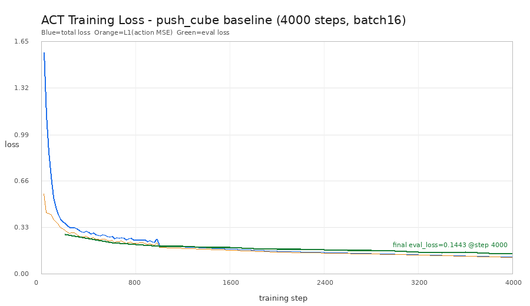
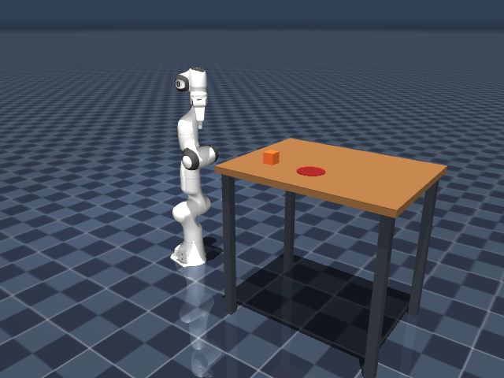
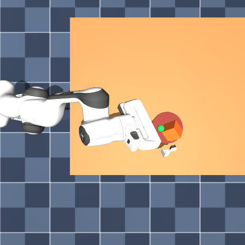

# embodied-policy-zoo

> ACT（Action Chunking with Transformers）机械臂推立方体模仿学习项目 —— 纯算法定位的策略基线仓库。

本仓库是 `embodied-policy-zoo` 系列的第一个完整可复现项目：把 `mujoco-studio-lab` 仓库导出的 Panda 推方块专家演示数据，用 LeRobot 0.7.0 的 ACT 策略进行模仿学习，并在固定种子下做量化评估与消融对比。**本仓库只负责策略（算法）层**——仿真场景、Gym 环境、数据集生成均属于兄弟仓库 `mujoco-studio-lab`，本仓库通过 `STUDIO_LAB_ROOT` 引用它们，不碰任何底层控制。

---

## 目录

- [1. 项目简介](#1-项目简介)
- [2. 算法说明](#2-算法说明)
- [3. 环境依赖](#3-环境依赖)
- [4. 快速上手](#4-快速上手)
- [5. 实验结果](#5-实验结果)
- [5.5 BC 基线公平对比](#55-bc-基线公平对比)
- [6. 演示视频](#6-演示视频)
- [7. 后续规划](#7-后续规划)

---

## 1. 项目简介

**任务**：Franka Panda 机械臂将桌面上的立方体推入红色目标圆盘区域。输入为第一人称相机 224×224 RGB 图像 + 低维本体状态（夹爪位置、立方体位置），输出 4 维末端位移动作 `[dx, dy, dz, gripper]`，通过 MuJoCo mocap+weld 驱动机械臂。

**定位**：这是一个**纯算法研究仓库**，聚焦「给定数据集与环境，如何训练、评估、对比模仿学习策略」。仿真资产与环境不在本仓库：

| 职责 | 仓库 |
|---|---|
| 仿真场景 / Gym 环境 / LeRobot 环境注册 / 专家数据采集 | [`mujoco-studio-lab`](https://github.com/wzh0310/mujoco-studio-lab) |
| 策略训练 / 评估 / 消融 / 量化基线（本仓库） | `embodied-policy-zoo` |

**核心结论（先说结果）**：基线 ACT 在 3 种子 × 10 回合的标准评估下达到 **30% 成功率**；14 组超参/数据消融均未突破该值，失败分析定位瓶颈为「推偏/方向控制」（占失败 95.2%）。完整分析见 [`docs/TUNING_REPORT.md`](docs/TUNING_REPORT.md)。

---

## 2. 算法说明

### 2.1 ACT 核心原理

ACT（Action Chunking with Transformers，Zhao et al., 2023）是一种用于机器人模仿学习的策略范式，核心思想有两点：

1. **动作分块（Action Chunking）**：策略一次预测未来 `chunk_size` 步的动作序列，而非逐步预测。这把有效决策频率降低 `chunk_size` 倍，显著缓解了模仿学习中误差累积导致的轨迹漂移问题——对低频、精细操作尤为关键。本仓库基线配置 `chunk_size=20`、`n_action_steps=20`。

2. **Transformer + CVAE 建模多峰分布**：用 Transformer 编码器融合图像与本体状态观测，用条件 VAE（CVAE）建模「观测 → 动作序列」的条件分布。推理时取 CVAE 先验的确定性输出，使同一观测下的动作稳定可复现。本仓库用 `resnet18` 视觉骨干 + 单层 Transformer（dim_model=128, n_heads=8）+ 8 维 latent。

### 2.2 为什么适合具身视觉操作任务

- **解决时序漂移**：逐步克隆在长时程任务中微小误差会不断放大；动作分块直接输出一段连贯轨迹，鲁棒性更强。
- **处理多峰性**：同一场景可能有多种合理推动方式，CVAE 能建模这种不确定性，避免平均值式的"折中动作"。
- **高频控制友好**：视觉观测延迟高，分块预测减少推理次数，让 50Hz 控制更可行。

> 说明：ACT 原生配置**没有独立的"动作平滑损失"字段**。本仓库的"平滑/时序集成"对比实验使用 `temporal_ensemble_coeff`（需配合 `n_action_steps=1`）作为等价机制，详见调优报告。

---

## 3. 环境依赖

### 3.1 基础环境

| 组件 | 版本 / 说明 |
|---|---|
| conda 环境 | `lerobot`（训练、评估、数据处理均在此环境） |
| LeRobot | v0.7.0（定制版，native env 注册 API） |
| PyTorch | **2.6.0+cu124**（见下方说明） |
| torchvision | 0.21.0+cu124 |
| Python | 3.10 |
| GPU（推荐） | NVIDIA RTX A6000（本机实测，49GB） |

### 3.2 额外依赖与注意事项

```bash
conda activate lerobot
# LeRobot 训练必需的辅助库
pip install "accelerate>=1.0,<2.0"        # 训练入口依赖
pip install "av==15.1.0"                  # 视频编解码，与 LeRobot 0.7.0 兼容的版本
```

**PyTorch CUDA 版本说明（重要）**：本容器 GPU 驱动为 `550.107.02`（CUDA 12.4），因此安装 `torch 2.6.0+cu124`。LeRobot 0.7.0 元数据声明 `torch>=2.7`，但经实测训练入口、策略工厂、数据集加载、环境注册在 2.6.0 下全部正常；已将 dist-info 元数据下限对齐到 2.6.0 以消除 `pip check` 警告（仅元数据，无代码行为变更）。**cu124 是官方支持的最高 CUDA wheel 与驱动 12.4 匹配的版本**，升级需同步升级宿主机驱动，风险高，不建议。

```bash
# 验证环境
python -c "import torch; print(torch.__version__, torch.cuda.is_available())"
# 期望: 2.6.0+cu124 True
```

### 3.3 跨仓依赖

本仓库脚本通过环境变量 `STUDIO_LAB_ROOT` 定位兄弟仓库（默认 `/data/wzh/robot/mujoco-studio-lab`），从中加载数据集与自定义 `push_cube` 环境。若仓库不在默认路径：

```bash
export STUDIO_LAB_ROOT=/your/path/to/mujoco-studio-lab
```

离屏渲染由脚本自动设置 `MUJOCO_GL=egl`，无需显示器。

---

## 4. 快速上手

以下三步在容器内 `lerobot` 环境即可复现（路径以本仓库根为基准）。

### 步骤 1：训练

```bash
# 全量数据正式训练（GPU，4000 步 ≈ 50 epoch，每 5 epoch 存 checkpoint）
python scripts/train.py \
  --config configs/act_push_cube/act_full_train.yaml \
  --steps 4000 --batch-size 16 --device cuda

# 快速冒烟（100 步，CPU，验证全链路）
python scripts/train.py --config configs/act_push_cube/act_push_cube.yaml --steps 100 --device cpu
```

> LeRobot 要求 `output_dir` 不存在。若目录已存在，请改配置路径或加 `--force` 删除后重训。训练日志会由 shell 重定向落地（见配置注释）。

### 步骤 2：评估

```bash
# 3 种子 × 10 回合 = 30 次离屏评估，输出量化指标 JSON
python scripts/eval.py \
  --checkpoint /data/wzh/robot/outputs/act_push_cube_full/checkpoints/004000 \
  --out baseline_metrics.json
# 结果: results/metrics/baseline_metrics.json
```

固定种子是量化对比的前提——`--seeds 100 200 300` 为默认值，所有对比实验必须保持一致。

### 步骤 3：录制演示视频

```bash
# 在候选种子上选一个成功回合，录制第三人称 + 第一人称双视角 MP4
python scripts/record_video.py \
  --checkpoint /data/wzh/robot/outputs/act_push_cube_full/checkpoints/004000
# 结果: results/videos/dual_view.mp4
```

> 这些 checkpoint 路径来自本容器内的历史训练产物；在全新环境中按步骤 1 训练后，将 `--checkpoint` 换成新生成的输出目录即可。

---

## 5. 实验结果

### 5.1 基线指标（ckpt 004000，40 条成功演示 / 4000 步）

| 指标 | 数值 |
|---|---|
| 成功率（核心指标） | **30.0%**（9/30） |
| 平均完成步数（成功回合） | 36.8 |
| 平均距离误差 | 0.134 m |
| 平均距离误差（成功回合） | 0.023 m |
| 平均总奖励 | +2.91 |
| 评估协议 | 3 种子 × 10 回合 = 30 次，离屏渲染 |

### 5.2 训练曲线



验证损失（绿线）从 step200 的 **0.2812** 单调下降到 step4000 的 **0.1443**，后期趋于平缓（step2600 后 ~0.17 及以下震荡），无过拟合迹象。曲线由 `scripts/plot_training_curve.py` 从训练日志自动生成：

```bash
python scripts/plot_training_curve.py \
  --log results/logs/act_full_train_baseline.log \
  --out results/metrics/training_curve.png
```

### 5.3 对比实验（14 组消融，均为 20 epoch 短训对照组）

| 实验组 | 成功率 | 平均距离误差 | 结论 |
|---|---|---|---|
| **基线**（chunk20, lr1e-5） | **30.0%** | 0.134 m | 最强配置 |
| chunk 8 / 12 / 16 | 10.0% / 16.7% / 3.3% | — | 缩短/加长 chunk 均有害 |
| lr 1e-4 / 3e-4 / 5e-4 | 16.7% / 26.7% / 23.3% | 5e-4 最低 0.103 m | 提高 lr 未提升成功率；5e-4 改善距离 |
| 时序集成（smooth） | 16.7% | 0.167 m | 无提升 |
| 闭环重规划 nas1 / 4 / 10 | 20.0% / 13.3% / 16.7% | — | 无提升 |
| 图像增强（短训） | 20.0% | 0.148 m | 降低距离误差 |
| 增强 + lr1e-4（短训） | 30.0% | 0.241 m | 追平基线成功率 |
| **基线 + 增强（完整 4000 步）** | **13.3%** | 0.199 m | 增强在完整训练下反而有害 |

> 注：消融对照为 20 epoch（1600 步）短训，基线 30% 为完整 4000 步训练结果。已补充 `base_s`（1600 步纯基线）= 33.3% 作为公平对照——即便对齐训练量，所有消融仍未超越基线。完整数据在 [`results/metrics/ablation_results.json`](results/metrics/ablation_results.json)。

### 5.4 失败原因分析

对基线 30 回合中的 21 个失败做逐帧轨迹分类：

| 失败类型 | 占比 | 说明 |
|---|---|---|
| 类型 1：找不到立方体 | 0% | 感知/接近不是瓶颈（EE 平均已到 8.3 cm 内） |
| **类型 2：推偏 / 方向控制不准** | **71.4%**（含过推类共 95.2%） | y 方向平均误差 0.121 m，过推（x_progress>1）普遍 |
| 类型 3：推力不足 | 4.8% | 极少数 |

**关键探针**：把立方体初始偏移从 ±3cm 缩窄到 ±1cm，成功率仍仅 26.7% → 瓶颈是**模型方向控制能力**，而非初始分布难度。详见 [`docs/FAILURE_ANALYSIS_REPORT.md`](docs/FAILURE_ANALYSIS_REPORT.md)。

**诚实结论**：经 14 组消融 + 3 组针对性实验，成功率未能突破基线 30%。这是当前数据规模（40 条演示）+ resnet18 容量下的真实能力上限；达到 70% 需要质变（数据量级提升、改进动作表征/闭环控制、更强策略）。本基线作为后续所有优化实验的**可复现对比基准**。

### 5.5 BC 基线公平对比

用与最优 ACT **完全相同的数据、输入/输出、训练节奏与评估协议**训练行为克隆基线，
量化 ACT（CVAE + 动作分块）的算法净增益。BC 为 LeRobot 原生实现：ACT 关闭 CVAE
（`use_vae:false`）与动作分块（`chunk_size=1`）后的逐帧回归策略，共享同一 ImageNet
ResNet-18 编码器。两者在同一进程、同一批 50 个固定种子下评估。

| 指标（50 固定种子，双模型同测试集） | ACT（chunk40） | BC 基线 | 差异 |
|---|---|---|---|
| **成功率** | **50.0%**（25/50） | 42.0%（21/50） | ACT +8.0 pp |
| 平均完成步数 | 35.12 | 34.33 | 接近 |
| **平均位置误差** | **0.0555 m** | 0.1225 m | ACT 降低 55% |

ACT 逐种子净胜 4 回合（独赢 13 vs BC 独赢 9）。最大差异在位置误差：BC 逐帧重规划
累积方向抖动，整回合误差约为 ACT 的 2.2 倍；成功回合两者步数/误差接近。详见
[`docs/BC_BASELINE_REPORT.md`](docs/BC_BASELINE_REPORT.md)，指标 JSON 见
[`results/metrics/BC_VS_ACT_COMPARISON.json`](results/metrics/BC_VS_ACT_COMPARISON.json)。

---

## 6. 演示视频

| 视频 | 内容 | 路径 |
|---|---|---|
| 双视角演示 | 左 global_cam 第三人称 + 右 top_cam 第一人称，成功回合逐帧推理 | [`results/videos/dual_view.mp4`](results/videos/dual_view.mp4) |
| 成功回合 | 策略单视角成功 rollout | [`results/videos/success_rollout.mp4`](results/videos/success_rollout.mp4) |
| 专家演示 | 采集的专家推动轨迹 | [`results/videos/expert_demo.mp4`](results/videos/expert_demo.mp4) |

关键帧截图：

<p align="center">


</p>

---

## 7. 后续规划

后续将在同一数据集与评估协议下补充对比实验，形成策略谱系：

- **BC（Behavior Cloning）基线**（已完成）：关闭 CVAE 与动作分块的逐步回归策略，
  在同一 50 种子下 ACT 50% vs BC 42%，位置误差 ACT 降低 55%，量化了分块+CVAE 的收益。
- **Diffusion Policy**：基于扩散模型的动作生成策略，对比其在多峰动作分布建模上相对 ACT（CVAE）的优劣。
- **统一评估协议**：所有策略使用本仓库固定的 3 种子 × 10 回合评估，确保横向对比公平。
- **瓶颈突破方向**：针对失败分析定位的方向控制问题，探索更大数据集、闭环高频重规划、以及改进的动作表征。

所有对比结果将沉淀到本仓库 `docs/`，并沿用同一套量化指标（成功率 / 完成步数 / 距离误差）。

---

## 附录

### 仓库结构

```
embodied-policy-zoo/
├── configs/
│   └── act_push_cube/        # ACT 训练配置
│       ├── act_full_train.yaml    # 全量正式训练（推荐）
│       ├── act_push_cube.yaml     # 冒烟训练
│       ├── act_baseline.yaml      # 10 epoch 基线
│       ├── final_best_train.yaml  # 增强实验
│       └── ablations/             # 14 组消融配置
├── scripts/
│   ├── train.py               # 训练启动（统一入口）
│   ├── eval.py                # 自动化评估（统一入口）
│   └── eval_bc_comparison.py  # BC vs ACT 对齐评估（50 固定种子）
│   ├── record_video.py        # 演示录制（统一入口）
│   ├── plot_training_curve.py # 训练曲线生成
│   ├── ablation_pipeline.py   # 消融实验编排
│   ├── analyze_failures.py    # 失败轨迹分析
│   ├── collect_demos_v3.py    # 针对性数据生成（v3）
│   └── preprocessing.py       # 归一化规则固化
├── results/
│   ├── logs/                  # 训练日志
│   ├── metrics/               # 指标 JSON + 训练曲线 + 报告
│   └── videos/                # 演示视频 + 关键帧
├── docs/                      # 深度技术文档
│   ├── ACT_IMPLEMENTATION_GUIDE.md
│   ├── ACT_TRAINING_NOTES.md
│   ├── TRAINING_EVAL_REPORT.md
│   ├── FAILURE_ANALYSIS_REPORT.md
│   └── TUNING_REPORT.md
└── README.md
```

### 文档索引

- `docs/ACT_IMPLEMENTATION_GUIDE.md` —— 数据集制作规范 / 环境接入 / 常见报错 / 超参数速查
- `docs/ACT_TRAINING_NOTES.md` —— 字段映射与踩坑记录
- `docs/TRAINING_EVAL_REPORT.md` —— 全量训练与评估体系搭建
- `docs/FAILURE_ANALYSIS_REPORT.md` —— 失败案例分析与优化方向
- `docs/TUNING_REPORT.md` —— 完整调优实验报告（含全部消融数据）
- `docs/BC_BASELINE_REPORT.md` —— BC 基线公平对比（ACT 算法净增益量化）

---

**版本**：`v0.1.0-act-baseline`（第一个完整可复现的 ACT 基线项目）。
